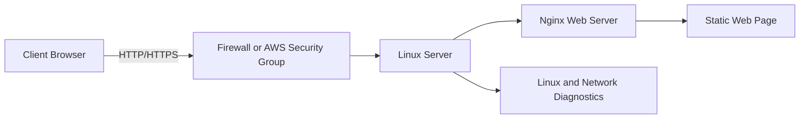

# Linux, Networking & Cloud Infrastructure Lab

A hands-on beginner infrastructure project covering Linux administration,
network diagnostics, secure remote access, web server deployment, and
connectivity testing.

## Objectives

- Explore Linux users, groups, permissions, processes and services.
- Inspect IP addresses, routing tables and DNS resolution.
- Understand ports, host firewalls and AWS security groups.
- Deploy a static webpage using Nginx on a Linux server.
- Validate service availability and document test results.

## Architecture



## Repository structure

- `scripts/linux-audit.sh` — reports system, user, process, network and SSH metadata.
- `scripts/network-check.sh` — checks DNS resolution, HTTPS connectivity and listening ports.
- `web/index.html` — sample webpage for the Nginx deployment.
- `docs/` — configuration notes and test results.
- `screenshots/` — evidence captured during the lab.

## Lab workflow

1. Identify the Linux distribution and inspect the system.
2. Review user/group membership and file permissions.
3. Inspect IP configuration, routing and DNS.
4. Configure secure SSH access on the target server.
5. Install and configure Nginx.
6. Deploy the sample webpage.
7. Test locally and from a separate client.
8. Document firewall and cloud security group rules.
9. Capture screenshots and record results.

## Run the diagnostic scripts

```bash
chmod +x scripts/*.sh
./scripts/linux-audit.sh
./scripts/network-check.sh example.com
```

## Web server deployment

On a disposable Ubuntu server or a server you are authorised to administer:

```bash
sudo apt update
sudo apt install -y nginx
sudo cp web/index.html /var/www/html/index.html
sudo systemctl enable --now nginx
sudo systemctl status nginx --no-pager
curl -I http://localhost
```

For a remote cloud deployment, configure the cloud security group to
allow inbound TCP 80 from an appropriate source for the demo. Restrict
SSH (TCP 22) to your own public IP where possible. Do not expose SSH to
the entire internet unnecessarily.

## Evidence and results

Add genuine screenshots and actual command output after completing each
step. Record the server OS, IP configuration, service status, ports,
firewall/security group rules and HTTP connectivity results.

**Deployment status:** Pending verification. This README describes the
planned lab; mark steps complete only after running and testing them.

## Security

Never commit private SSH keys, passwords, cloud credentials, `.env` files
or access tokens. Use SSH keys with restrictive permissions and least-privilege
network rules.
